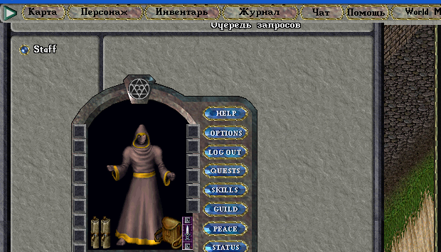
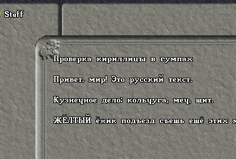

# Русский шард Ultima Online на POL

Собственный игровой сервер Ultima Online на базе [PenUltima Online (POL) 100.2.0](https://www.polserver.com/) и открытого клиента [ClassicUO](https://www.classicuo.eu/). Цель — полностью русскоязычный мир: сообщения сервера, диалоги NPC, названия предметов, интерфейс клиента.

## Что уже работает

- Ядро POL 100.2.0 собрано из исходников под Linux (GCC 16, C++20).
- Развёрнут дистрибутив **ModernDistro** (AoS/ML-механики).
- Мир **Британия** сконвертирован из клиентских файлов: `7168x4096`, статики, maptile, мульти.
- Сервер слушает `2593`, клиент ClassicUO подключается.
- Персонаж входит в мир, карта Британии рендерится (проверено скриншотом).
- Расставлены **26 584 предмета мирового декора**: обстановка лавок,
  таверн, домов и доков, светильники и вывески (`.worlddecor status`).
- Расставлены **2078 динамических дверей** домов и городских зданий Британии
  (объединённый набор из World of Dream и decoratefacets):
  открываются, закрываются, не распадаются и не дублируются при перезапуске.
- Спавн расширен 15 регионами из World of Dream: леса, болота, ледяной
  остров, орочьи и undead-точки. Генератор — `tools/merge_spawnregions.py`.
- Добавлены **732 dungeon-телепорта**, **117 guard-постов** и
  **230 merchant-узлов** (`.worldteleporters`, `.worldguards`, `.worldmerchants`).
- Русский текст в сообщениях сервера отображается корректно (POL автоматически отправляет UTF-8 как Unicode-пакет).
- Клиентский `Cliloc.rus` собран из перевода сообщества: ~7 400 строк интерфейса, свойств и названий предметов.





## Структура

```
client/        файлы клиента UO (7.0.x, MUL) — не в git
clientapp/     ClassicUO (Linux x64) — не в git
server/        рабочий каталог POL: скрипты, конфиги, realm, data
src/           исходники: polserver, ModernDistro, ClassicUO, WorldOfDream — не в git
tools/         инструменты перевода и работы с cliloc
locale/        каталоги переводов
docs/          документация и статус проекта
scripts/       скрипты запуска и сборки
logs/          логи
```

## Требования

- Linux x86_64, GCC 13+ (проверено на GCC 16), CMake 3.22+, Python 3.10+.
- Файлы клиента Ultima Online (MUL, версия 7.0.x). В проекте используются файлы из личной установки владельца шарда.
- Для клиента: ClassicUO Linux x64 (уже распакован в `clientapp/`).

## Сборка ядра

```bash
./scripts/build-pol.sh
```

Скрипт собирает `pol`, `ecompile`, `uoconvert`, `uotool`, `poltool`, `runecl` и копирует их в `server/`.

## Запуск

```bash
./scripts/run-server.sh      # сервер (порт 2593), работает в переднем плане
./scripts/run-client.sh      # клиент ClassicUO
```

Остановка — `./scripts/stop-server.sh` (или Ctrl+C в терминале сервера,
или `systemctl --user stop uo-shard`). POL по SIGINT/SIGTERM сохраняет мир
в `server/data/*.txt` и только потом выходит, поэтому «убивать» процесс
через `kill -9` нельзя — потеряется прогресс.

Тестовый персонаж для проверки мира: аккаунт `drovosek` / `drovosek`
(навыки, характеристики и 500 золотых в банке выдаёт
`scripts/include/testplayers.inc`, конфиг — `config/testplayers.cfg`).

Учётная запись администратора по умолчанию: `admin` / `admin` (сменить!).

Автозапуск (systemd, пользовательский сервис):

```bash
./scripts/install-systemd.sh
systemctl --user status uo-shard
```

Резервные копии (последние 14 архивов в `backups/`):

```bash
./scripts/backup.sh
```

## Конвертация мира

```bash
./scripts/rebuild-world.sh
```

Скрипт заново собирает `realm/britannia` из файлов в `client/`. Занимает около 10 секунд.

## Локализация

Два независимых слоя:

1. **Клиент** — `client/Cliloc.rus`. ClassicUO загружает `Cliloc.enu`, затем накладывает `Cliloc.rus`; язык задаётся в `clientapp/settings.json` (`"lang": "rus"`). Кириллические глифы уже есть в `unifont*.mul` этого клиента.
2. **Сервер** — тексты в `.src`-скриптах и конфигах. POL 100 автоматически определяет UTF-8 в `SendSysMessage`, `Say`, `PrintTextAbove` и отправляет Unicode-пакет, поэтому достаточно перевести строки на русский в UTF-8.

Инструменты:

```bash
python3 tools/extract_strings.py       # каталог строк сервера
python3 tools/apply_translation.py ... # применение перевода
./scripts/build-locale.sh              # сборка Cliloc.rus из locale/ru/
```

## Статус и план

Подробности — в [docs/STATUS.md](docs/STATUS.md).

Ближайшие задачи:

- [ ] Перевести основные сообщения сервера (вход, команды, крафт, бой, торговцы).
- [ ] Перевести имена и описания NPC/предметов в конфигах.
- [ ] Расширить `Cliloc.rus` на остальные строки клиента.
- [ ] Локализовать книги, таблички и квесты.
- [ ] Настроить автозапуск (systemd) и резервное копирование.
- [ ] Проверить клиент на Windows и на реальном клиенте 7.0.x.

## Развёртывание

Пошаговая инструкция и чек-лист безопасности — в [docs/DEPLOY.md](docs/DEPLOY.md).

## Правовая заметка

Проект не распространяет файлы игры. Для работы нужна легальная копия клиента Ultima Online. Ultima Online — торговая марка Electronic Arts.
